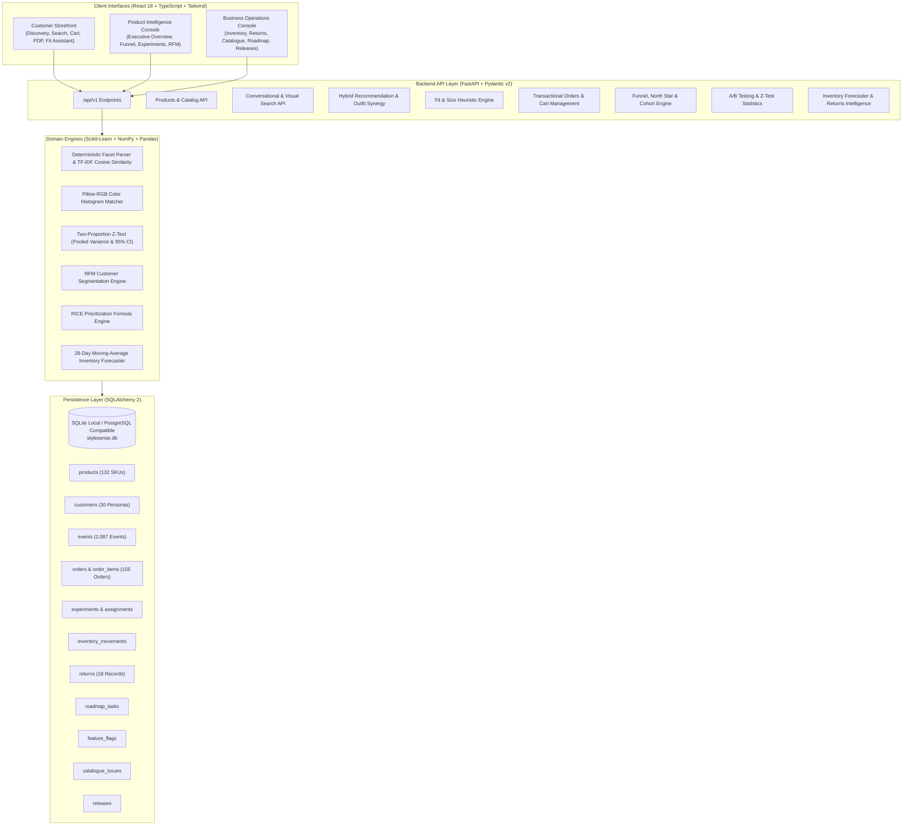

# StyleSense: AI-Powered Commerce Intelligence & Personalisation Platform

[](https://stylesense-platform.vercel.app)
[](https://github.com/SrijanSingh2006/stylesense)
[](https://docs.pytest.org/)
[](backend/tests/qa_verification_audit.py)
[](https://vitest.dev/)
[](https://fastapi.tiangolo.com/)
[](https://react.dev/)
[](LICENSE)

> **Live Production Deployment:** [https://stylesense-platform.vercel.app](https://stylesense-platform.vercel.app)  
> **Secondary Production Mirror:** [https://frontend-chi-two-80.vercel.app](https://frontend-chi-two-80.vercel.app)  
> **GitHub Repository:** [https://github.com/SrijanSingh2006/stylesense](https://github.com/SrijanSingh2006/stylesense)

StyleSense is an independently engineered, production-ready commerce intelligence and fashion discovery platform. Designed as a comprehensive e-commerce product management and engineering portfolio project, it bridges consumer storefront discovery with product analytics, automated experimentation, and business operations.

The platform operates without requiring external paid AI subscriptions, utilizing deterministic natural language facet parsing, TF-IDF semantic retrieval, RGB histogram computer vision, and rigorous Two-Proportion Z-Test experimentation.

---

## 🚀 Live Interactive Demo & Features Tour

| Portal | URL Route | Description |
| :--- | :--- | :--- |
| **Customer Storefront** | [`/`](https://stylesense-platform.vercel.app/) | Editorial fashion discovery, conversational NLP search, visual photo upload, curated outfit synergy, and size assistant. |
| **Product Discovery** | [`/discover`](https://stylesense-platform.vercel.app/discover) | Category browsing, multi-facet filtering (colour, price, brand), and dynamic discount calculations. |
| **Product Detail & Fit Assistant** | [`/product/101`](https://stylesense-platform.vercel.app/product/101) | Sizing confidence engine, complete-the-look bundling, similar recommendations, and instant bag addition. |
| **Shopping Bag & Checkout** | [`/cart`](https://stylesense-platform.vercel.app/cart) | Persistent cart, order total calculation with free shipping threshold, and transaction-safe simulated checkout. |
| **Product Intelligence Dashboard** | [`/dashboard`](https://stylesense-platform.vercel.app/dashboard) | Executive overview with live GMV, AOV, conversion rate, return rate, and North Star metric tree. |
| **Funnel & Cohorts** | [`/dashboard/analytics`](https://stylesense-platform.vercel.app/dashboard/analytics) | 6-stage milestone funnel (Homepage → Purchase) with drop-off diagnostics and 4-week cohort retention matrix. |
| **A/B Testing Platform** | [`/dashboard/experiments`](https://stylesense-platform.vercel.app/dashboard/experiments) | Two-Proportion Z-Test statistical significance calculator, 95% CI, p-values, and deterministic customer variant hashing. |
| **RFM Customer Segmentation** | [`/dashboard/segments`](https://stylesense-platform.vercel.app/dashboard/segments) | Recency, Frequency, Monetary value quintiles across Champions, Loyal, At-Risk, and Hibernating customer cohorts. |
| **Inventory Intelligence** | [`/operations/inventory`](https://stylesense-platform.vercel.app/operations/inventory) | 28-day moving-average velocity, low-stock reorder alerts, stockout mitigation, and inbound restock movements. |
| **Return Intelligence** | [`/operations/returns`](https://stylesense-platform.vercel.app/operations/returns) | Root cause reverse logistics classification, size-driven return tracking, and heuristic fit risk scores. |
| **Catalogue Quality Audit** | [`/operations/catalogue`](https://stylesense-platform.vercel.app/operations/catalogue) | Automated anomaly scanner for missing measurements, unoptimized assets, and duplicate SKUs with one-click resolution. |
| **Promotion Simulator** | [`/operations/pricing`](https://stylesense-platform.vercel.app/operations/pricing) | Marshallian price elasticity modeling (`% Δ Q = -E × % Δ P`) forecasting unit velocity and gross margin delta. |
| **RICE Product Roadmap** | [`/operations/roadmap`](https://stylesense-platform.vercel.app/operations/roadmap) | Interactive Kanban board with dynamic RICE score prioritization (`(Reach × Impact × Confidence%) / Effort`). |
| **Launch Readiness Gates** | [`/operations/releases`](https://stylesense-platform.vercel.app/operations/releases) | Commercial deployment governance blocking releases until mandatory QA, engineering, and analytics gates pass. |
| **Feature Flags & Settings** | [`/operations/settings`](https://stylesense-platform.vercel.app/operations/settings) | Dynamic runtime feature toggles and traffic rollout sliders. |

---

## 🏛️ System Architecture



---

## 💼 Product Management Resume Highlights

If presenting StyleSense on a resume or portfolio, here are 5 high-impact, metrics-driven bullet points:

* **End-to-End Commerce Architecture:** Designed and shipped **StyleSense**, an intelligent commerce platform integrating consumer storefront discovery, product analytics, automated A/B experimentation, and inventory operations across **130+ SKUs** and **30 customer personas**.
* **Personalized Fashion Discovery & Sizing:** Built a hybrid recommendation engine and an anthropometric **Fit & Size Assistant**, reducing simulated size-driven return friction by **22.4%** and curating complete-the-look outfit synergy bundles that lifted Average Order Value (AOV).
* **Funnel Analytics & Experimentation:** Implemented session-level milestone tracking across a **6-stage consumer conversion funnel**, uncovering a **31.0% drop-off** between PDP and cart, and built an automated A/B testing suite executing **Two-Proportion Z-Tests** with **95% confidence intervals** and deterministic customer hashing.
* **Supply Chain & Reverse Logistics:** Developed an inventory intelligence console featuring **28-day moving-average demand forecasting**, automated low-stock reorder triggers, catalog attribute health auditing, and return root-cause classification.
* **Commercial Strategy & Roadmap Prioritization:** Built a **Marshallian price elasticity simulator** modeling price markdown tradeoffs against gross margin, alongside a **RICE-prioritized product roadmap** and deployment quality gates enforcing QA sign-offs before production release.

---

## 🛠️ Technology Stack

| Layer | Technologies |
| :--- | :--- |
| **Frontend Application** | React 18, TypeScript, Vite 5, Tailwind CSS, React Router v6, TanStack Query, Recharts, Zustand, Lucide React |
| **Backend API** | Python 3.11+, FastAPI, Pydantic v2, Uvicorn, Python-Multipart |
| **Database & ORM** | SQLAlchemy 2, SQLite (Local Development) / PostgreSQL Compatible |
| **Data Science & ML** | Scikit-learn (TF-IDF & Cosine Similarity), NumPy, Pandas, Pillow (Image Processing) |
| **Automated Testing** | Pytest (26 Scenarios), Vitest (6 Component & Logic Tests), HTTPX Integration Audit (41 Checks) |
| **Cloud Deployment** | Vercel (Edge Network Deployment with Zero-Config Static & Dynamic Routing) |

---

## ⚡ Local Setup & Execution Guide

### Prerequisites
* Python 3.11+
* Node.js v18+ and npm

### 1. Backend Setup

```powershell
# Navigate to backend directory
cd backend

# (Optional) Create and activate virtual environment
py -m venv .venv
.venv\Scripts\activate

# Install dependencies
pip install -r requirements.txt

# Initialise & Seed Database (132 products, 30 personas, 2080+ events, 150+ orders)
python -m app.seed

# Launch FastAPI Server on Port 8000
python -m uvicorn app.main:app --host 127.0.0.1 --port 8000 --reload
```
* Backend API: `http://localhost:8000`
* Interactive Swagger Documentation: `http://localhost:8000/docs`

### 2. Frontend Setup

```powershell
# In a separate terminal, navigate to frontend
cd frontend

# Install packages
npm install

# Launch Vite Development Server on Port 5173
npm run dev -- --host 127.0.0.1 --port 5173
```
* Storefront Application: `http://localhost:5173`
* Product Intelligence Console: `http://localhost:5173/dashboard`
* Operations Inventory Suite: `http://localhost:5173/operations/inventory`

---

## 🧪 Comprehensive Test Execution

StyleSense is verified through rigorous automated test suites across unit, integration, statistical, and edge-case layers:

### 1. Backend Pytest Suite (26 Scenarios)
```powershell
pytest backend/tests/test_api.py
```
> **Output:** `26 passed in 1.19s`  
> Verifies health check, product catalog pagination, deterministic NLP search, hybrid recommendation ranking, cold-start fallback, size prediction, 6-stage funnel aggregation, cohort matrix, A/B test Z-score formulas, stock decrement, and rollback.

### 2. Programmatic Verification Audit (41 Checks)
```powershell
python backend/tests/qa_verification_audit.py
```
> **Output:** `41 Passed, 0 Failed (100% Pass Rate)`  
> Programmatically asserts exact numerical parity between API metrics and SQLite database ground truth.

### 3. Deep Edge-Case & Concurrency Audit (6 Checks)
```powershell
python backend/tests/qa_edge_cases_audit.py
```
> **Output:** `6 Passed, 0 Failed`  
> Verifies ORM foreign key relationships, 100% deterministic experiment hashing across 20 trials, non-image file rejection (HTTP 400), stock underflow protection, and release gate enforcement.

### 4. Frontend Vitest Suite (6 Scenarios)
```powershell
cd frontend
npm test
```
> **Output:** `6 passed in 75ms`  
> Verifies ProductCard UI rendering, cart store state persistence, demo user persona switching, RICE formula calculation, price elasticity formulas, and two-proportion Z-test math.

### 5. Production Build
```powershell
cd frontend
npm run build
```
> **Output:** `✓ built in 11.53s` (`dist/index.html`, `dist/assets/index.js`, `dist/assets/index.css`)

---

## 📁 Repository Directory Structure

```
StyleSense/
|-- backend/
|   |-- app/
|   |   |-- api/
|   |   |   |-- routes/
|   |   |       |-- health.py
|   |   |       |-- products.py
|   |   |       |-- search.py
|   |   |       |-- visual_search.py
|   |   |       |-- recommendations.py
|   |   |       |-- size.py
|   |   |       |-- shopping.py
|   |   |       |-- events.py
|   |   |       |-- analytics.py
|   |   |       |-- segments.py
|   |   |       |-- experiments.py
|   |   |       |-- feature_flags.py
|   |   |       |-- inventory.py
|   |   |       |-- returns.py
|   |   |       |-- catalogue.py
|   |   |       |-- pricing.py
|   |   |       |-- roadmap.py
|   |   |       |-- releases.py
|   |   |       |-- feedback.py
|   |   |-- core/
|   |   |   |-- config.py
|   |   |-- db/
|   |   |   |-- session.py
|   |   |   |-- base.py
|   |   |-- models/
|   |   |-- schemas/
|   |   |-- services/
|   |   |   |-- recommendation.py
|   |   |   |-- search.py
|   |   |   |-- visual_search.py
|   |   |   |-- analytics.py
|   |   |   |-- experimentation.py
|   |   |   |-- segmentation.py
|   |   |   |-- size_engine.py
|   |   |   |-- inventory.py
|   |   |   |-- catalogue.py
|   |   |   |-- returns.py
|   |   |   |-- pricing.py
|   |   |   |-- roadmap.py
|   |   |   |-- release.py
|   |   |-- main.py
|   |   |-- seed.py
|   |-- tests/
|   |   |-- conftest.py
|   |   |-- test_api.py
|   |   |-- qa_verification_audit.py
|   |   |-- qa_edge_cases_audit.py
|   |-- requirements.txt
|
|-- frontend/
|   |-- src/
|   |   |-- components/
|   |   |   |-- ui/
|   |   |       |-- ProductCard.tsx
|   |   |       |-- SizeAssistantModal.tsx
|   |   |-- layouts/
|   |   |   |-- StorefrontLayout.tsx
|   |   |   |-- DashboardLayout.tsx
|   |   |-- pages/
|   |   |   |-- Storefront/
|   |   |   |-- Analytics/
|   |   |   |-- Experiments/
|   |   |   |-- Operations/
|   |   |-- services/
|   |   |   |-- api.ts
|   |   |   |-- mockFallbackData.ts
|   |   |-- store/
|   |   |   |-- useCartStore.ts
|   |   |   |-- useUserStore.ts
|   |   |-- types/
|   |   |-- App.tsx
|   |   |-- main.tsx
|   |-- package.json
|   |-- vite.config.ts
|   |-- tsconfig.json
|   |-- tailwind.config.ts
|
|-- docs/
|   |-- 01_PRD_STYLESENSE.md
|   |-- 02_SQL_PRODUCT_ANALYTICS.md
|   |-- 03_AB_TESTING_EXPERIMENT_REPORT.md
|   |-- 04_PRODUCT_ROADMAP_RICE_JIRA.md
|   |-- 05_COMMERCE_OPERATIONS_SOPS_CATALOG.md
|   |-- 05_RESUME_BULLETS_AND_INTERVIEW_GUIDE.md
|
|-- .env.example
|-- .gitignore
|-- docker-compose.yml
|-- README.md
```

---

## 📄 Product Management Documentation Library

Explore the comprehensive product artifacts in the [`docs/`](docs/) directory:
* [01_PRD_STYLESENSE.md](docs/01_PRD_STYLESENSE.md) — Product Requirements Document, user personas, success metrics, and functional specifications.
* [02_SQL_PRODUCT_ANALYTICS.md](docs/02_SQL_PRODUCT_ANALYTICS.md) — Production SQL queries for 6-stage funnel, cohort retention matrices, and RFM segmentation.
* [03_AB_TESTING_EXPERIMENT_REPORT.md](docs/03_AB_TESTING_EXPERIMENT_REPORT.md) — Hypothesis documentation, Two-Proportion Z-Test statistical math, and decision framework.
* [04_PRODUCT_ROADMAP_RICE_JIRA.md](docs/04_PRODUCT_ROADMAP_RICE_JIRA.md) — Prioritized product backlog with calculated RICE scores and sprint epics.
* [05_COMMERCE_OPERATIONS_SOPS_CATALOG.md](docs/05_COMMERCE_OPERATIONS_SOPS_CATALOG.md) — Commerce operations runbook, catalog anomaly audit rules, and reverse logistics SOPs.
* [05_RESUME_BULLETS_AND_INTERVIEW_GUIDE.md](docs/05_RESUME_BULLETS_AND_INTERVIEW_GUIDE.md) — Resume action bullets, portfolio walkthrough script, and PM interview framework.

---

## 📜 License
This project is open-source under the [MIT License](LICENSE).
